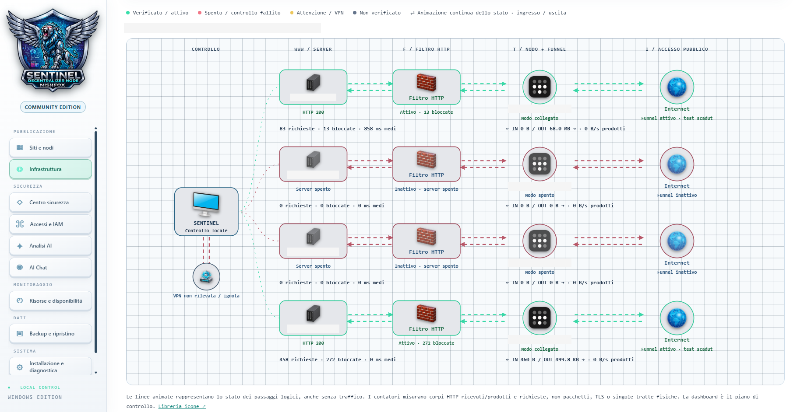
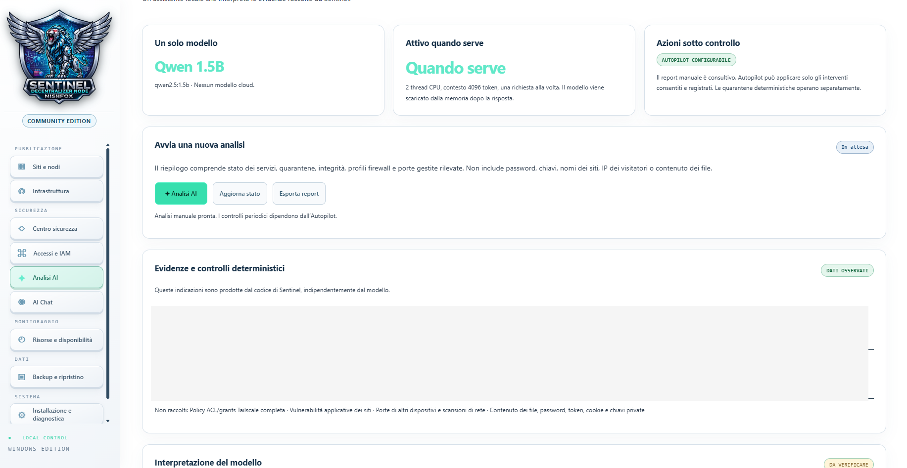
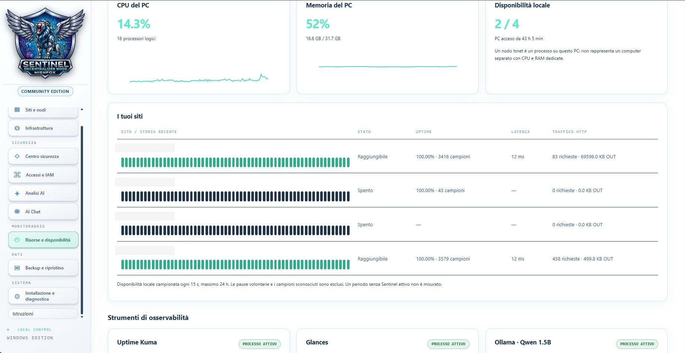

# Sentinel Decentralized Node — Community Edition

**[🌐 Visit the project website](https://nishfox.github.io/Sentinel-Decentralized-Node/)**

[English](README.md) · [Italiano](Leggimi.md)

Sentinel is a control center for hosting and publishing multiple static websites from your Windows PC. Each project has its own folder, local server and dedicated Tailscale node. Files are served by the host PC, and you choose when each site becomes public.

**Windows · Self-hosted · Local dashboard · Optional local AI**

[Illustrated user manual](manuale-ENG.html) · [Read the manual on GitHub](manuale-ENG.md)

## Video demo

[English - 4K video](https://github.com/Nishfox/Sentinel-Decentralized-Node/releases/download/v1.0.0/Sentinel-Live-Demo-English-4K-Music.mp4) · [Italiano - video 4K](https://github.com/Nishfox/Sentinel-Decentralized-Node/releases/download/v1.0.0/Sentinel-Live-Demo-Italiano-4K.mp4)

[Watch both videos on the project website](https://nishfox.github.io/Sentinel-Decentralized-Node/#demo)

## Host an existing website

1. Set up the administrator account in the Windows installer wizard.
2. Open the Sentinel shortcut or run `Avvia-Sentinel.bat`.
3. Choose **New site / node**. Copy your existing HTML, CSS, JavaScript and images into the project folder. Replace the sample page with your `index.html`.
4. Select **Start**, then **Preview**.
5. Connect and authorize the dedicated Tailscale node, then select **Publish**.
6. Open the exact HTTPS address on the project card. Test from a phone on mobile data as well.

Some dashboard labels and technical messages may remain in Italian.

## Features

| Area | Capabilities |
| --- | --- |
| Sites | Manage folders, servers, previews, logs and dedicated nodes |
| Publishing | Enable HTTPS with Tailscale Funnel and check DNS, TLS and HTTP |
| Infrastructure | Inspect local server, HTTP filter, node connection and public status separately |
| Security | Limit requests and concurrency, block hidden files, apply HTTP quarantines and check SHA-256 file integrity |
| Monitoring | Inspect resources and availability through optional CrowdSec, Glances and Uptime Kuma integrations |
| Backups | Export ZIP archives and restore them as new, stopped projects |
| Access | Protect the dashboard, administration APIs and backups with an administrator account |
| AI | Query local project evidence and relevant source excerpts with Qwen, including clarification choices |
| Autopilot | Run periodic checks and restore disabled HTTP filters under limited, logged rules |
| Interface | Choose light or dark mode and the language of the main menus |

## Help and diagnostics

The **Instructions** tag below **Installation and diagnostics** opens the illustrated HTML manual in a separate window. The language selector translates text where supported by the browser. Screenshots retain their original language.

**Run check** requests a fresh local component check. Rows update one at a time. Green indicates a successful check, yellow indicates attention or pending verification, and red indicates an error. Saved installation report results are identified separately.

## Languages

The website offers 11 language choices: Italian, English, Russian, French, German, Chinese, Spanish, Arabic, Hindi, Sinhala and Tamil.

The installer asks for a language at startup. Standard pages are available in Italian, English, Russian, French, German, Spanish, Arabic and Tamil. Custom setup pages use Italian or English. Some messages remain in Italian. The installer language is not yet passed to the dashboard.

GitHub renders this English README by default. Use the language links above to open another static document. GitHub Pages can run the website language selector.

## Offline and online use

With the components installed, local previews, backups and Qwen inference can work offline. Initial component and model downloads need Internet access. Public hosting requires the PC to remain on and connected, a Tailscale account and the relevant tailnet permissions.

## Windows installation

[Download the Windows ZIP](https://github.com/Nishfox/sentinel-decentralized-node/releases/download/v1.0.0/Sentinel-Windows-1.0.0.zip).

Launch the wizard by double-clicking the installer or use PowerShell, either with a single command or step by step. [Installation guide](installazione-ENG.md).

The wizard connects the PC to Tailscale when needed. In the dashboard, connect and authorize each project's dedicated node, then publish it. Your tailnet may require HTTPS or Funnel approval in the Tailscale console. [Full publishing procedure](siti-ENG.md).

The current Windows installer is unsigned. Windows may show a SmartScreen warning. Download the package from the project's official source.

## Documentation

- [Sites and publishing](siti-ENG.md)
- [Security, monitoring and AI](sicurezza-ai-ENG.md)
- [Testing and limitations](collaudo-ENG.md)
- [Publishing on GitHub and signing releases](github-ENG.md)
- [Project website](https://nishfox.github.io/Sentinel-Decentralized-Node/)
- [Third-party components](THIRD-PARTY-ENG.md)
- [Italian documentation](Leggimi.md)

## Author and editions

Community Edition is distributed under the MIT License. Enterprise Edition will be proprietary with separate terms.

[Privacy](privacy-ENG.md) · [Attribution](attribuzione-ENG.md)

### Enterprise Edition · In development

The initial scope covers shared projects across PCs, synchronization, revocable per-user and per-project permissions, reviewed or direct updates, history and rollback.

Planned extensions include corporate SSO and 2FA, token access, centralized backups, containers, remote terminal, Web Studio, VS Code integration and federation across locations. Priorities will follow early customer requirements. [Full Enterprise roadmap](enterprise-ENG.md).

## Project status

The public export test suite recorded **31 passes, 3 skips and 0 failures**. The recorded stress test completed 30,000 local requests across six temporary sites. A later automated suite run recorded 24 passes, 9 failures and 1 skip, including loopback access failures. The user reported a successful installation on a second PC after an initial error that remains to be reviewed. Public HTTPS responses were observed from two project nodes. A full independent installation, reboot and uninstall assessment remains outstanding.

Community Edition hosts static sites. Managed application backends, PostgreSQL and two-factor authentication remain future work. Translations are partial. Filters operate at the HTTP application layer. AI output can be incorrect and requires verification.

## Why I am building Sentinel

I am Nishfox. My aim is to simplify technical tools and favor local and offline use wherever practical, reducing dependence on recurring subscriptions. Community Edition is my free, open-source contribution. Public publishing still requires Internet access and Tailscale permissions.

*The Community is free. Development time and the electricity bill have not found a free plan yet. 😄*

If this helps you, consider a star, useful feedback or sharing the project.

## Support development

Community Edition is free and open source. If you find it useful, you can [support development with a voluntary PayPal contribution](https://paypal.me/nishtattoo) of any amount. A star, useful feedback or sharing the project also helps.

Contributions are optional and do not purchase goods or services.

## Dashboard preview

**Created by Nishfox · 2026**
