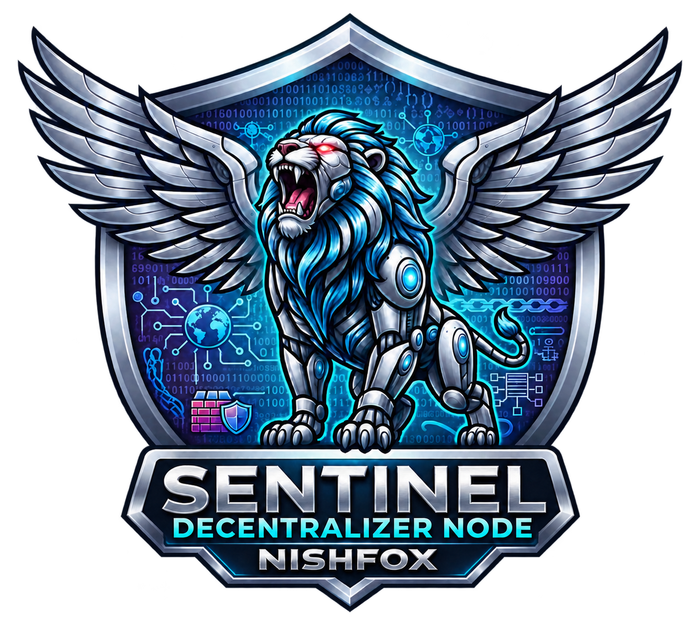

# Enterprise Edition · Roadmap

[English](enterprise-ENG.md) · [Italiano](enterprise.md)

Sentinel Enterprise is in development and will use a proprietary license. This catalog describes proposed capabilities. Availability, requirements, integrations and priorities will be established during development.

## Collaboration and remote projects

- Catalog of shared projects across computers in the same tailnet.
- Local working copies of remote projects.
- Synchronization back to the host PC.
- Per-user, per-project read and edit access.
- Separate permission to apply updates without further approval.
- Permission revocation from the host PC.
- Update requests with file-difference review.
- Conflict detection before overwriting.
- Owner, Developer, Designer, Security Operator and Viewer roles.
- Role-based folder access.
- Version history and individual-file restore.
- Applied-update history identifying the author.

## Identity and access

- Multiple users and RBAC roles.
- Corporate SSO integration.
- Keycloak and LDAP directory integration.
- Two-factor dashboard authentication.
- Evaluation of TOTP and hardware security keys.
- Scoped personal tokens.
- Token expiration, rotation and revocation.
- Permission checks for read and update operations.

## Development environments and tools

- Isolated collaborator workspaces.
- Docker management from the dashboard.
- Container start, stop, restart and health inspection.
- CPU, RAM and network metrics for managed environments.
- Automatic restart policies after crashes.
- Per-environment CPU and RAM quotas.
- AI resource queues and limits, with GPU support to be assessed per platform.
- Remote terminal with dedicated authorization.
- Administrative maintenance and log-rotation scripts.
- SFTP file access.
- Shared workspaces using supported protocols.
- External editor integration.
- Sentinel VS Code extension with connection status.
- Authorized file browsing from the developer panel.
- Approval requests sent directly from the editor.
- Browser-based Web Studio with dedicated user environments.
- Evaluation of a Sentinel Code Studio desktop client.

## Validation and deployment

- Separate test and production environments.
- Static code checks before deployment.
- AI-assisted change review.
- Tests and lint before approval.
- Deployment blocked when required checks fail.
- Human approval or direct application according to project permissions.
- Snapshots before applying updates.
- Automated deployment to supported services and containers.
- Rollback after problematic updates.
- Secrets managed separately from source files.
- Local dependency caching with validation and update policies.

## Audit and security

- Centralized administrative activity log.
- User, time, project and operation outcome recorded.
- Session and file-operation tracking.
- AI activity auditing with privacy and retention rules.
- Hash chaining to verify log integrity.
- Separate log copies and verification references to detect tampering.
- Behavioral anomaly monitoring.
- Tunnel and development-environment health checks.
- CrowdSec decisions integrated into centralized protection management.
- Assessment of platform-specific isolation protections.
- Administrative kill switch with a defined scope.
- Token revocation and environment shutdown during emergencies.
- Controlled recovery after emergencies.
- Live Control Room showing events and states.
- Alert priorities and filters to reduce duplicate notifications.
- Configurable Telegram notifications.
- Webhooks for Slack, Discord and SIEM systems.

## Backups and infrastructure

- Scheduled encrypted backups.
- Central destinations on corporate storage or private cloud.
- Snapshot retention and rotation policies.
- Periodic backup recovery and validation.
- Discovery and status of authorized Sentinel nodes.
- Private node-to-node communication over Tailscale.
- Instance state and metric exchange.
- Federation across locations.
- Routing based on state, load and latency.
- Study of data replication with database-specific SQLite and PostgreSQL procedures.
- Node failover with data consistency checks.
- Support packages and service levels to be defined.

## Requirements and status

Community retains its hosting, diagnostics, local backup and local AI features. Enterprise adds collaboration, access governance and centralized management. Listed capabilities require development and testing. Linux- or container-based features need compatible environments. Performance, tamper resistance and any regulatory requirements require specific validation.

**Created by Nishfox · 2026**
