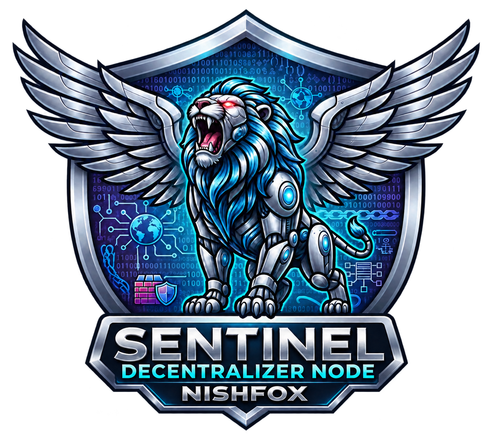

<link rel="alternate" hreflang="en" href="enterprise-ENG.html">
<link rel="alternate" hreflang="it" href="enterprise.html">

# Enterprise Edition · Roadmap

[English](enterprise-ENG.md) · [Italiano](enterprise.md)

Sentinel Enterprise è in sviluppo e sarà distribuito con una licenza proprietaria. Questo catalogo descrive le funzionalità proposte. Disponibilità, requisiti, integrazioni e priorità saranno definiti durante lo sviluppo.

## Collaborazione e progetti remoti

- Catalogo dei progetti condivisi tra computer della stessa tailnet.
- Apertura di copie di lavoro locali di progetti remoti.
- Sincronizzazione delle modifiche verso il PC host.
- Accesso in lettura e modifica assegnato per utente e progetto.
- Permesso separato per applicare aggiornamenti senza ulteriore approvazione.
- Revoca dei permessi dal PC host.
- Richieste di aggiornamento con revisione delle differenze tra file.
- Individuazione dei conflitti prima della sovrascrittura.
- Ruoli Owner, Developer, Designer, Security Operator e Viewer.
- Limitazione delle cartelle accessibili in base al ruolo.
- Storico delle versioni e ripristino di singoli file.
- Registro degli aggiornamenti applicati e del loro autore.

## Identità e accessi

- Gestione di più utenti e ruoli RBAC.
- Integrazione SSO aziendale.
- Integrazione con Keycloak e directory LDAP.
- Autenticazione a due fattori per la dashboard.
- Valutazione di TOTP e chiavi hardware come metodi di autenticazione.
- Token personali con permessi limitati.
- Scadenza, rotazione e revoca dei token.
- Verifica dei permessi sulle operazioni di lettura e aggiornamento.

## Ambienti di sviluppo e strumenti

- Workspace isolati per i collaboratori.
- Gestione di container Docker dalla dashboard.
- Avvio, arresto, riavvio e controllo dello stato dei container.
- Metriche CPU, RAM e rete per gli ambienti gestiti.
- Politiche di riavvio automatico dopo un crash.
- Quote CPU e RAM per singolo ambiente.
- Code e limiti di utilizzo delle risorse AI, con supporto GPU da verificare per piattaforma.
- Terminale remoto con autorizzazioni dedicate.
- Script amministrativi per manutenzione e rotazione dei log.
- Accesso ai file tramite SFTP.
- Workspace condivisi tramite protocolli supportati.
- Integrazione con editor esterni.
- Estensione Sentinel per VS Code con stato della connessione.
- Esplorazione dei file autorizzati dal pannello dello sviluppatore.
- Invio di una richiesta di approvazione direttamente dall’editor.
- Web Studio accessibile dal browser, con ambienti dedicati agli utenti.
- Valutazione di un client desktop Sentinel Code Studio.

## Validazione e rilascio

- Ambienti di prova separati dalla produzione.
- Controlli statici del codice prima del rilascio.
- Analisi AI delle modifiche come supporto alla revisione.
- Esecuzione di test e lint prima dell’approvazione.
- Blocco del rilascio quando i controlli obbligatori falliscono.
- Approvazione umana oppure applicazione diretta secondo i permessi del progetto.
- Snapshot prima dell’applicazione degli aggiornamenti.
- Distribuzione automatizzata verso servizi e container supportati.
- Ripristino di una versione precedente dopo un aggiornamento problematico.
- Gestione dei segreti separata dai file sorgenti.
- Cache locale delle dipendenze con politiche di verifica e aggiornamento.

## Audit e sicurezza

- Registro centralizzato delle attività amministrative.
- Registrazione di utente, orario, progetto e risultato delle operazioni.
- Tracciamento delle sessioni e delle operazioni sui file.
- Audit delle attività AI con criteri di riservatezza e conservazione.
- Verifica di integrità dei registri mediante concatenazione di hash.
- Copie dei registri e riferimenti di verifica separati per rilevare alterazioni.
- Monitoraggio di comportamenti anomali.
- Health check di tunnel e ambienti di sviluppo.
- Integrazione delle decisioni CrowdSec nella gestione centralizzata delle protezioni.
- Valutazione delle protezioni di isolamento disponibili su ciascuna piattaforma.
- Kill switch amministrativo con ambito definito.
- Revoca dei token e arresto degli ambienti durante un’emergenza.
- Procedura di ripresa controllata dopo l’emergenza.
- Control Room con eventi e stati aggiornati in tempo reale.
- Priorità degli avvisi e filtri per ridurre le notifiche ripetitive.
- Notifiche Telegram configurabili.
- Webhook verso Slack, Discord e sistemi SIEM.

## Backup e infrastruttura

- Backup pianificati e cifrati.
- Destinazioni centralizzate su storage aziendale o cloud privato.
- Politiche di conservazione e rotazione degli snapshot.
- Ripristino e verifica periodica dei backup.
- Individuazione e stato dei nodi Sentinel autorizzati.
- Comunicazioni private tra nodi attraverso Tailscale.
- Scambio di stato e metriche tra istanze.
- Federazione tra sedi.
- Instradamento delle richieste secondo stato, carico e latenza.
- Studio della replica dei dati con procedure specifiche per SQLite e PostgreSQL.
- Failover tra nodi con verifica della consistenza dei dati.
- Offerte di assistenza e livelli di servizio da definire.

## Requisiti e stato

La Community Edition mantiene le proprie funzioni di hosting, diagnostica, backup locale e AI locale. Enterprise aggiunge collaborazione, governo degli accessi e gestione centralizzata. Le capacità elencate richiedono sviluppo e collaudo. Le funzionalità basate su Linux o container richiederanno un ambiente compatibile. Le prestazioni, la resistenza alle manomissioni e gli eventuali requisiti normativi saranno oggetto di verifiche specifiche.

**Creato da Nishfox · 2026**
