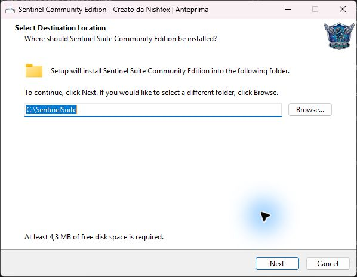
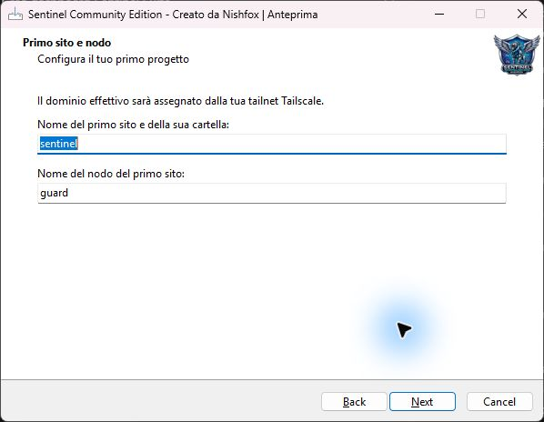
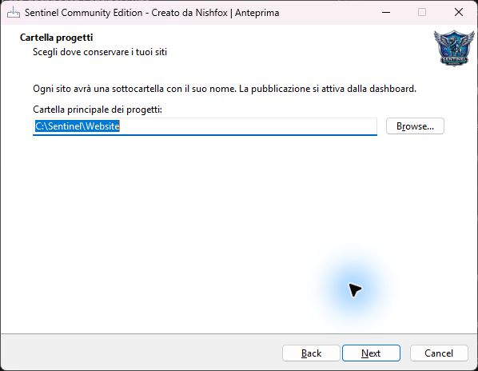
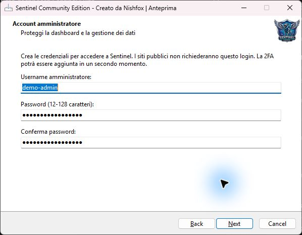
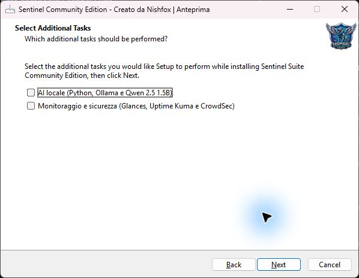
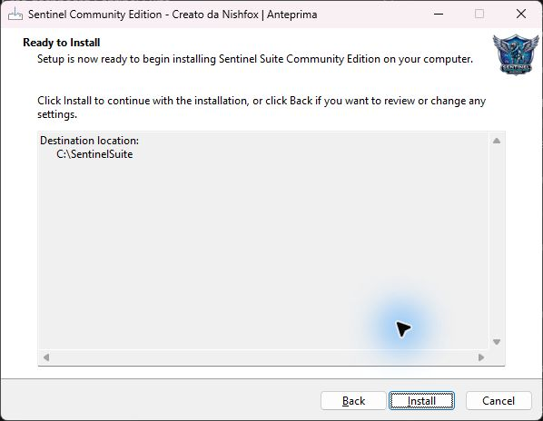
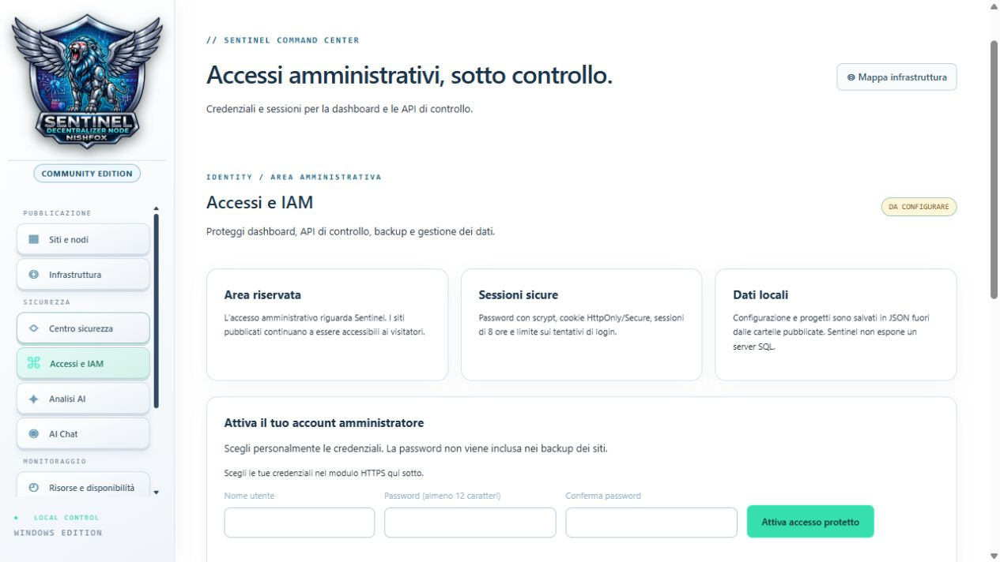

# Windows installation and first launch

[English](installazione-ENG.md) · [Italiano](installazione.md)

Sentinel hosts websites you have already built. The wizard installs the dashboard, prepares the first project folder and configures administrator access. Check your site locally before publishing it.

## 1. Before starting

Use 64-bit Windows, an account able to approve installation and an Internet connection for missing components. Download the installer from the official release when available. A source-code ZIP is for manual setup. Choose a location for your sites, have your Tailscale account ready and choose a new dashboard password.

If you already use Sentinel, export a backup before migrating. The wizard rejects a destination containing an existing Sentinel configuration. Windows may request UAC approval. Verify the file's origin. The Nishfox credit identifies the author.

Screenshots were captured in a preview wizard using demonstration data. Paths and required disk space vary. The current summary page contains additional details.

## 2. Application destination



In **Select Destination Location**, keep the suggested folder or use **Browse**. This folder holds Sentinel and its launcher. Select **Next**.

## 3. First website and node



| Field | Example | Purpose |
| --- | --- | --- |
| First site and folder name | studio-tattoo | Project name and subfolder |
| First site node name | studio-tattoo | Requested Tailscale node name |

Use 1–63 lowercase letters, digits and internal hyphens. Tailscale confirms the final domain, including the tailnet suffix. Continue with **Next**.

## 4. Projects folder



Choose a dedicated web-content folder. With `D:\Sites` and project name `studio-tattoo`, the website folder is `D:\Sites\studio-tattoo`. Use **Browse** to change it and **Next** to continue. Keep private files outside published folders.

## 5. Administrator account



Use a 3–32 character username containing letters, digits, dots, hyphens or underscores. Enter a 12–128 character password and repeat it. This account protects administration. Two-factor authentication remains future work.

## 6. Optional components



| Option | Components | Purpose |
| --- | --- | --- |
| Local AI | Python, Ollama, Qwen 2.5 1.5B | AI Analysis and AI Chat |
| Monitoring and security | Glances, Uptime Kuma, CrowdSec | Monitoring and security integrations |

For a light installation, leave both unchecked. The wizard reuses compatible prerequisites found in supported locations. WinGet is required to install missing optional prerequisites. The first model download requires Internet access.

## 7. Review and install



In **Ready to Install**, review your choices. Use **Back** to edit or **Install** to proceed. A PowerShell window may show progress. Keep it open until completion.

The bootstrap attempts to install Tailscale when absent. Complete the official Tailscale sign-in when requested and return to setup. Publishing is enabled later from the project card.

If an optional component fails, follow the wizard message to retry with `scripts/install-wizard-extras.ps1`. After adding components, stop and reopen Sentinel to load them.

## 8. Launch and sign in

1. Open **Sentinel Suite** from Start or run `Avvia-Sentinel.bat` in the installation folder.
2. Use the address shown by the launcher. Defaults are `https://127.0.0.1:4311/` and `http://127.0.0.1:4310/`. Use HTTPS for administration.
3. Sign in with the credentials chosen in setup. **Access and IAM** shows account status.



## 9. Preview and publish

Find the project in **Sites and nodes**, select **Folder** and copy your website files. Place `index.html` at the project root with its assets. Select **Start**, then **Preview**, and check pages, images and links. Connect the dedicated node and authorize it when requested. Select **Publish** and use the exact HTTPS address from the card. Test on a phone using mobile data. Keep the address unchanged, including the absence of `www.`.

[Read the illustrated manual](manuale-ENG.html).

## Tailscale from sign-in to publication

The installer connects the PC to Tailscale, reusing an existing session when available. Each site's embedded node is a separate device in the tailnet and may need its own initial authorization through **Authorize node**.

**Publish** enables Funnel. If Tailscale requires HTTPS or Funnel approval, complete it in the tailnet console and retry. Ask your tailnet administrator if your account lacks permissions. Use **Verify HTTPS** and mobile data to check the result. **Remove from public** closes Funnel.

A portfolio and a documentation site on the same PC have separate nodes. You can publish the portfolio while keeping documentation local.

## 10. First-launch troubleshooting

| Symptom | Check |
| --- | --- |
| Destination already used | Export a backup and choose a new application folder |
| Dashboard unavailable | Relaunch the BAT, use its displayed URL and inspect port errors |
| Certificate warning | Check local TLS configuration in Installation and diagnostics |
| Preview works, public site fails | Check node authorization, Funnel status, exact URL and Verify HTTPS |
| AI or monitoring unavailable | Review optional installation results and restart Sentinel |

`scripts/verify-installation.ps1` checks the launcher and components. Save necessary backups and stop Sentinel before uninstalling.

## PowerShell installation

Both methods download and open the same wizard. Copy the direct installer asset URL from the official release when available. Select the optional AI and monitoring packages inside setup.

### Method 1 · One command

Paste the command into PowerShell, then enter the direct EXE URL.

```powershell
$url = Read-Host 'Direct Sentinel installer EXE URL'; $setup = Join-Path $env:TEMP ('SentinelSuite-' + [guid]::NewGuid() + '.exe'); Invoke-WebRequest -Uri $url -OutFile $setup -UseBasicParsing -ErrorAction Stop; Start-Process -FilePath $setup -Wait
```

### Method 2 · Step by step

Run these in the same terminal, in order.

```powershell
$url = Read-Host 'Direct Sentinel installer EXE URL'
```

```powershell
$setup = Join-Path $env:TEMP ('SentinelSuite-' + [guid]::NewGuid() + '.exe')
Invoke-WebRequest -Uri $url -OutFile $setup -UseBasicParsing -ErrorAction Stop
```

After a successful download, launch setup.

```powershell
Start-Process -FilePath $setup -Wait
```

Complete the wizard, approve Windows elevation when appropriate and sign in to Tailscale when requested.

### Running from source

Use Node.js 20 or later and open `Avvia-Sentinel.bat` in the project folder. Configure administrator access through the HTTPS dashboard. [Security and AI integrations](sicurezza-ai-ENG.md).

**Created by Nishfox · 2026**
