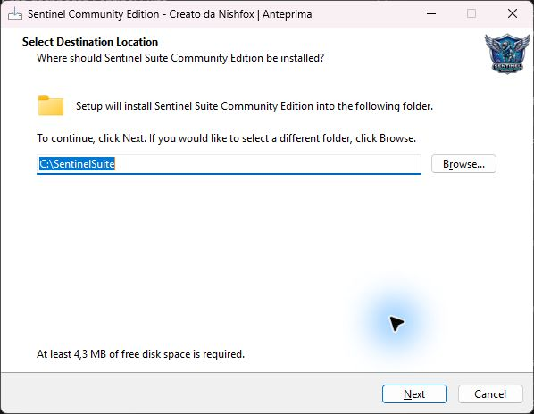
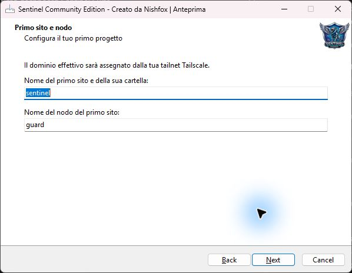
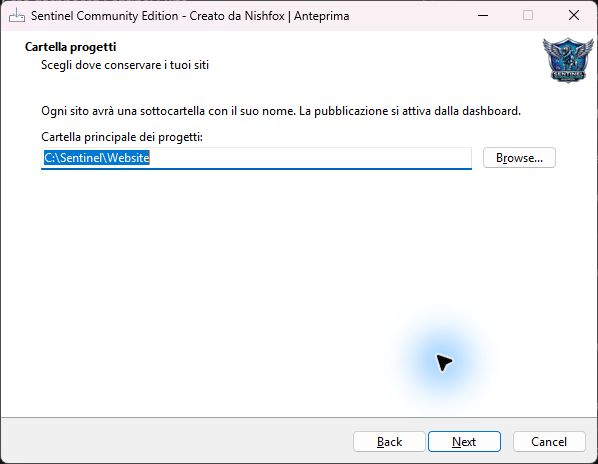
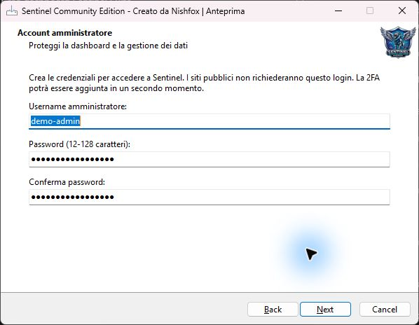
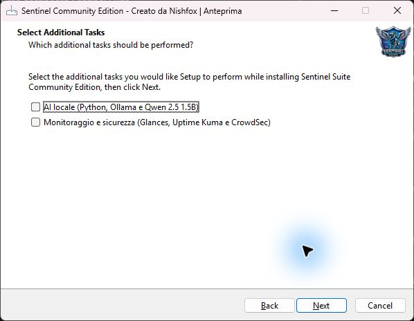
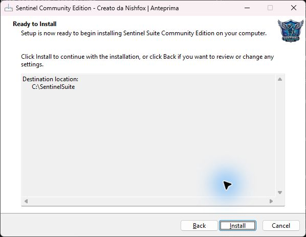
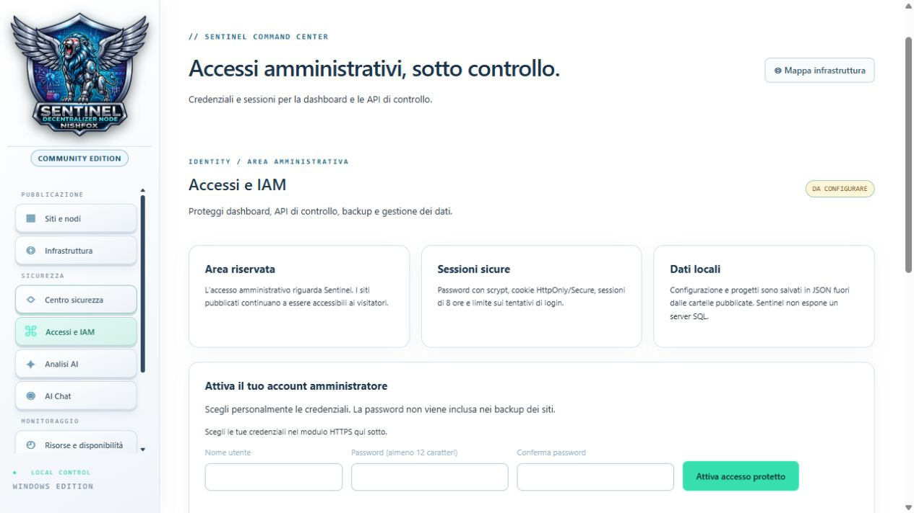

---
---
# Installazione e primo avvio su Windows

[English](installazione-ENG.md) · [Italiano](installazione.md)

Sentinel Suite Community Edition ospita siti che hai già preparato. Il wizard installa la dashboard, prepara una cartella per il primo progetto e configura l'accesso amministrativo. Puoi verificare il sito in locale prima di renderlo pubblico.

## 1. Prima di aprire il wizard

- Usa Windows a 64 bit (x64 o ARM64), un account che possa autorizzare l'installazione e una connessione Internet per scaricare i componenti mancanti.
- Scarica **SentinelSuite-Setup.exe** dagli asset della release ufficiale, se disponibile. Il file ZIP dei sorgenti è destinato all'avvio manuale.
- Scegli dove conservare i file dei siti. Tieni a disposizione un account Tailscale e prepara una password nuova per la dashboard.
- Se hai già Sentinel, esporta un backup prima di migrare. Il wizard rifiuta una destinazione che contiene già una configurazione Sentinel.

Apri l'eseguibile. Windows può chiedere l'autorizzazione tramite UAC. Verifica la provenienza del file prima di concederla. La dicitura **Creato da Nishfox** identifica l'autore nel wizard.

> Le schermate del wizard sono state catturate in anteprima con dati dimostrativi. Percorsi e spazio richiesto variano nella procedura reale.

## 2. Destinazione dell'applicazione



Nella prima schermata, **Select Destination Location**, lascia la destinazione proposta oppure usa **Browse…** per sceglierne una diversa. Questa cartella ospita i file di Sentinel e il launcher. Premi **Next**.

## 3. Primo sito e nodo



In **Primo sito e nodo** compila i due campi separatamente.

| Campo | Esempio | A cosa serve |
| --- | --- | --- |
| Nome del primo sito e della sua cartella | studio-tattoo | Identifica il progetto e la sua sottocartella |
| Nome del nodo del primo sito | studio-tattoo | Nome richiesto a Tailscale per il nodo dedicato |

Usa da 1 a 63 caratteri tra lettere minuscole, cifre e trattini interni. Il dominio effettivo verrà confermato da Tailscale e includerà il suffisso della tua tailnet. Premi **Next**.

## 4. Cartella progetti



In **Cartella progetti**, scegli una cartella dedicata ai contenuti web. Per esempio, se scegli `D:\Siti` e il nome del progetto è `studio-tattoo`, la cartella del sito sarà `D:\Siti\studio-tattoo`. Usa **Browse…** per cambiare percorso e **Next** per continuare. Conserva i dati privati fuori dalle cartelle destinate alla pubblicazione.

## 5. Account amministratore



Inserisci un nome utente di 3–32 caratteri tra lettere, cifre, punti, trattini e underscore. Scegli una password di 12–128 caratteri e ripetila nel campo di conferma. Questo account protegge la dashboard. Il supporto 2FA resta una funzionalità futura.

## 6. Componenti opzionali



| Opzione | Componenti | Quando selezionarla |
| --- | --- | --- |
| AI locale | Python, Ollama e Qwen 2.5 1.5B | Per usare Analisi AI e AI Chat |
| Monitoraggio e sicurezza | Glances, Uptime Kuma e CrowdSec | Per aggiungere monitoraggio e integrazioni di sicurezza |

Per una prima installazione leggera puoi lasciare entrambe le caselle deselezionate. Il wizard riusa i prerequisiti compatibili che rileva nei percorsi supportati. WinGet serve se mancano prerequisiti delle opzioni selezionate. Il primo download del modello richiede Internet.

## 7. Conferma e installa



In **Ready to Install** controlla destinazione e componenti selezionati. Usa **Back** per correggere una scelta oppure **Install** per procedere. Una finestra PowerShell può mostrare l'avanzamento. Tienila aperta fino alla conclusione.

Se Tailscale manca, il bootstrap prova a installarlo. Se richiede l'accesso, segui la finestra ufficiale di Tailscale e torna al wizard. L'installazione prepara il primo progetto. La pubblicazione si attiva dalla sua scheda nella dashboard.

Se un componente opzionale fallisce, segui il messaggio del wizard per riprovare con `scripts/install-wizard-extras.ps1`. Dopo l'installazione delle opzioni, se Sentinel è già aperto, usa **Arresta Sentinel** e riavvialo dal launcher.

## 8. Apri Sentinel e accedi

1. Dal menu Start apri **Sentinel Suite**, oppure fai doppio clic su **Avvia-Sentinel.bat** nella cartella di installazione.
2. Usa l'indirizzo mostrato dal launcher. Le porte predefinite sono `https://127.0.0.1:4311/` per HTTPS e `http://127.0.0.1:4310/` per HTTP. Per l'accesso amministrativo usa la dashboard HTTPS.
3. Accedi con l'utente e la password scelti nel wizard. In **Accessi e IAM** trovi lo stato dell'account.



## 9. Verifica il sito in locale e pubblicalo

1. In **Siti e nodi**, trova la scheda del progetto. Premi **Cartella** per aprire il percorso di pubblicazione.
2. Copia i file del tuo sito dentro la cartella. Se il sito usa un punto di ingresso statico, metti `index.html` nella radice del progetto insieme ai suoi asset.
3. Premi **Avvia**, poi **Anteprima**. Controlla pagina, immagini e link.
4. Per l'accesso dall'esterno, premi **Collega nodo** e autorizzalo in Tailscale se richiesto. Premi **Pubblica** e apri l'URL effettivo dalla scheda. Per provare come visitatore, apri lo stesso URL da un telefono su rete mobile. Copia l'indirizzo così com'è, senza aggiungere `www.`.

[Consulta il manuale illustrato per tutti i controlli della dashboard](manuale.html).

## Tailscale, dal primo accesso alla pubblicazione

1. **Installazione del PC.** Il wizard cerca il client Tailscale e lo installa se manca. Se il PC è già collegato, riusa la sessione. Altrimenti accedi dal flusso ufficiale Tailscale.
2. **Nodo del progetto.** Dopo aver provato il sito in anteprima, premi **Collega nodo** nella sua scheda. Sentinel avvia il nodo dedicato. Se compare **Autorizza nodo**, apri il collegamento ufficiale e autorizza il nodo nella tailnet desiderata. Il login del PC e questa autorizzazione riguardano due dispositivi distinti nella tailnet. Ripeti la prima autorizzazione per gli altri progetti quando richiesta.
3. **Pubblicazione.** Premi **Pubblica** per configurare Funnel. Se Tailscale richiede di abilitare HTTPS o Funnel, completa il passaggio nella console della tailnet e riprova da Sentinel. Se ti mancano i permessi, rivolgiti al suo amministratore.
4. **Verifica.** Copia il link HTTPS effettivo dalla scheda senza aggiungere www. Usa **Verifica HTTPS** e prova da un telefono su rete mobile. Per chiudere Funnel, usa **Rimuovi dal pubblico**.

Per esempio, puoi avere un portfolio e un sito di documentazione sullo stesso PC. Ognuno ha il proprio nodo. Puoi pubblicare il portfolio e tenere la documentazione in anteprima locale.

## 10. Risolvi i problemi di primo avvio

| Sintomo | Controllo |
| --- | --- |
| Destinazione già in uso | Esporta un backup dall'installazione esistente e scegli una nuova cartella applicativa |
| La dashboard non si apre | Rilancia **Avvia-Sentinel.bat**, leggi l'URL mostrato e verifica eventuali errori sulle porte |
| Il browser segnala un problema con il certificato | Controlla la configurazione TLS locale da **Installazione e diagnostica** e il certificato previsto per la tua installazione |
| L'anteprima risponde ma il dominio pubblico no | Controlla autorizzazione del nodo, stato di Funnel e URL esatto dalla scheda; usa **Verifica HTTPS** quando disponibile |
| AI o monitoraggio non disponibili | Controlla il risultato dell'installazione opzionale e riapri Sentinel dopo il completamento |

Lo script `scripts/verify-installation.ps1` verifica il launcher e i componenti. Per disinstallare, esporta prima i backup necessari e usa **Arresta Sentinel**.


## Installazione con PowerShell

Entrambi i metodi scaricano e aprono lo stesso wizard. Quando disponibile, copia il link diretto all’asset **SentinelSuite-Setup.exe** dalla release ufficiale. Nel wizard scegli le cartelle e l’account, poi seleziona **AI locale** e **Monitoraggio e sicurezza** se vuoi installare anche i pacchetti opzionali.

### Metodo 1 · Download e avvio in un comando

Incolla la riga in PowerShell e, quando richiesto, incolla il link copiato.

```powershell
$url = Read-Host 'Link diretto a SentinelSuite-Setup.exe'; $setup = Join-Path $env:TEMP ('SentinelSuite-' + [guid]::NewGuid() + '.exe'); Invoke-WebRequest -Uri $url -OutFile $setup -UseBasicParsing -ErrorAction Stop; Start-Process -FilePath $setup -Wait
```

### Metodo 2 · Un passaggio alla volta

Esegui i blocchi nello stesso terminale, nell’ordine indicato.

1. Incolla il link della release quando PowerShell te lo chiede.

   ```powershell
   $url = Read-Host 'Link diretto a SentinelSuite-Setup.exe'
   ```

2. Scarica l’installer in un file temporaneo dedicato.

   ```powershell
   $setup = Join-Path $env:TEMP ('SentinelSuite-' + [guid]::NewGuid() + '.exe')
   Invoke-WebRequest -Uri $url -OutFile $setup -UseBasicParsing -ErrorAction Stop
   ```

3. Quando il download è riuscito, avvia il wizard.

   ```powershell
   Start-Process -FilePath $setup -Wait
   ```

Completa le schermate illustrate nella guida, rispondi alla richiesta di autorizzazione di Windows e accedi a Tailscale se richiesto.


### Avvio dai sorgenti

Usa Node.js 20 o successivo e apri **Avvia-Sentinel.bat** dalla cartella del progetto. Configura l'account in **Accessi e IAM** dalla dashboard HTTPS. Per le integrazioni consulta [Sicurezza e AI](sicurezza-ai.md).

---

**Creato da Nishfox · 2026**


