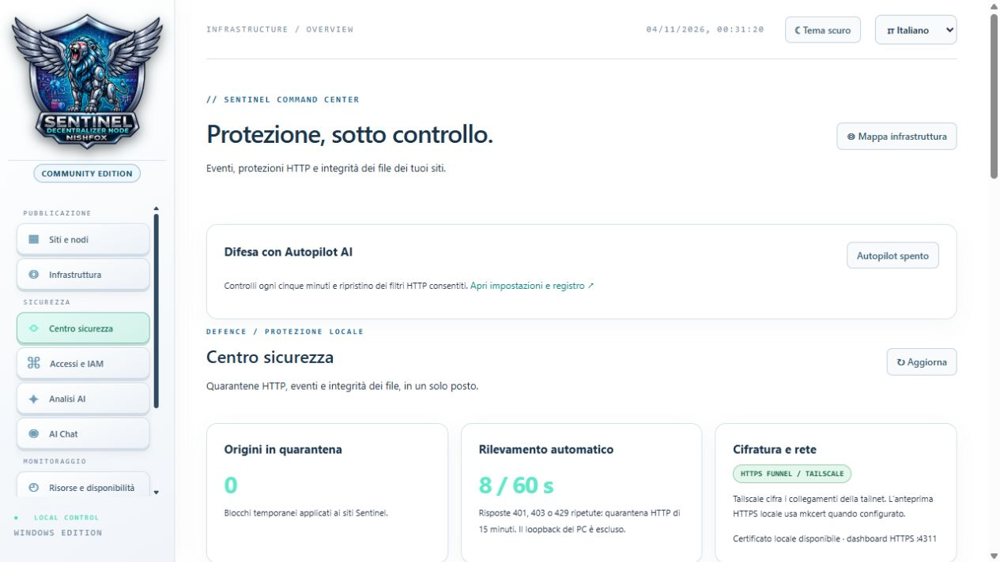
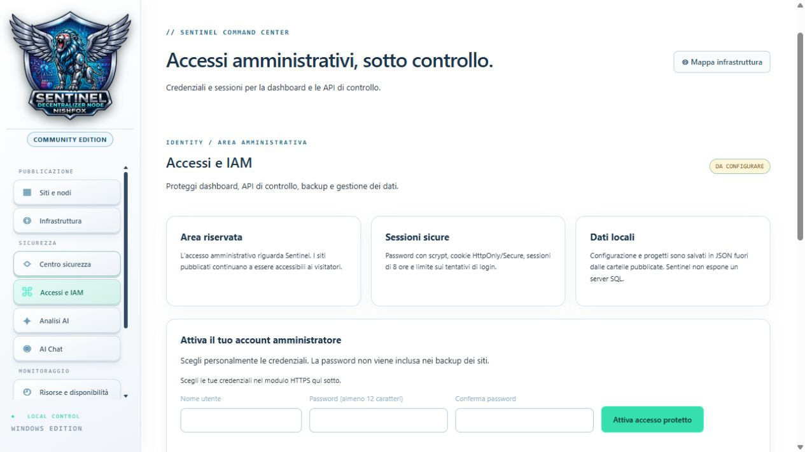
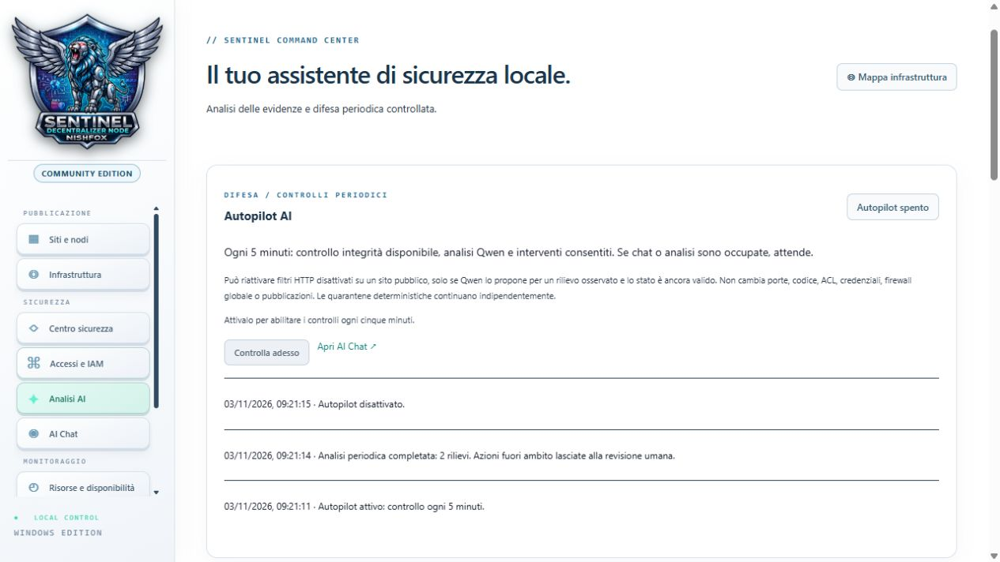
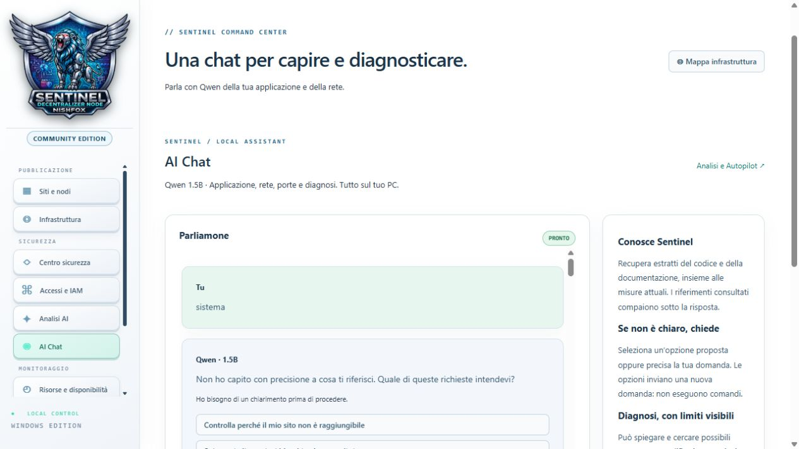
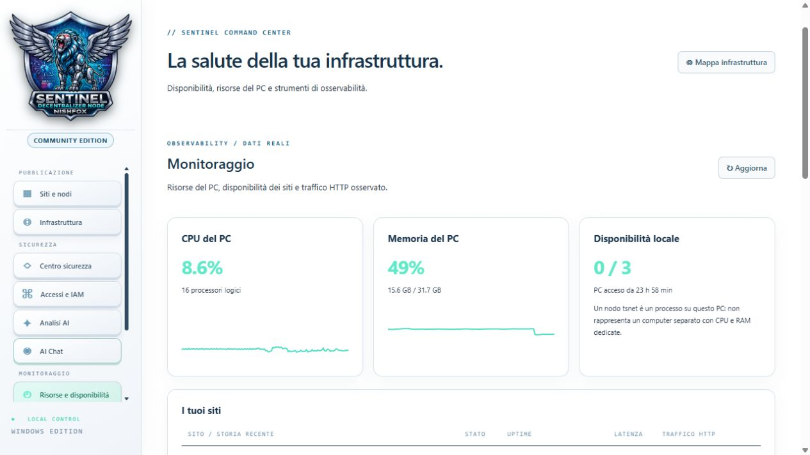
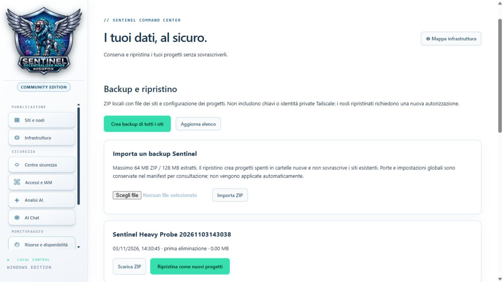
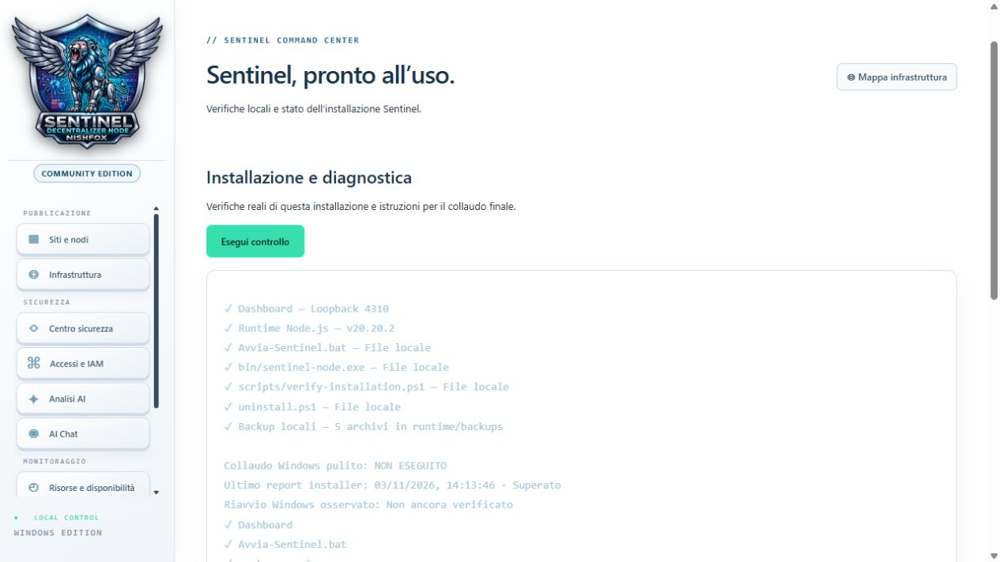

# Sentinel illustrated user manual
Sentinel Decentralized Node · Community Edition

[English](manuale-ENG.md) · [Italiano](manuale.md)

Each chapter corresponds to an A4 print page in the original manual. In HTML, use the index to jump between chapters and select screenshots to enlarge them. Screenshots retain their original interface language.

## 01 · Welcome
Sentinel hosts existing static websites. A project combines a file folder, a local server and a dedicated Tailscale node. Keep it stopped, preview it locally or publish it online.
- **Example** — Add a Portfolio project, copy `index.html`, CSS and images, then open Preview.
- **Sample page** — Replace the generated test page with your files.
- **Reading order** — Follow chapters 2–8 for your first site, Infrastructure for connection states and Backup before major changes.

## 02 · First launch on Windows
- **Installer** — Complete setup, choose the projects folder and enter username, password and confirmation.
- **Daily launch** — Open the shortcut or `Avvia-Sentinel.bat`. The launcher can reuse an existing instance. Use its displayed dashboard address.
- **Defaults** — HTTP 4310 and HTTPS 4311 when configured. Website preview ports are separate.
- **Initial check** — Verify account status in Access and IAM, then inspect the project before publishing.

## 03 · Finding your way around
- **Publishing** — Sites and nodes holds project cards. Infrastructure maps connections.
- **Security** — Security Center collects events and checks. Access and IAM protects administration. AI Analysis and AI Chat use the optional local model.
- **Monitoring, Data, System** — Resources and availability shows metrics and processes. Backup and restore manages ZIPs. Installation and diagnostics checks the installation.
- **Header** — Theme and language controls are near the clock. Logs and some technical text retain their original language.

## 04 · Adding a project
- **New site / node** — Enter a project name and inspect the requested node name, which identifies the project in Tailscale.
- **Save** — Prepares the project folder and a sample page if `index.html` is absent. The project appears in the list.
- **Folder** — Opens the location where you copy the prepared site, preserving subfolders.
- **Example** — Copy `images` if HTML references `images/photo.jpg`. Put `index.html` at the assigned root rather than in an extra export subfolder.

## 05 · Previewing locally
- **Start** — Starts the local server and its node connection. The site remains private until published.
- **Preview** — Opens the local address. If disabled, check the running state.
- **Stop** — Stops server and node while retaining the project and files.
- **Diagnosis** — If the sample page remains, replace `index.html`. For missing images, check filename, extension and relative path.

## 06 · Connecting a Tailscale node
- **Connect node** — Starts the project node. Local server and node have separate states.
- **Authorize node** — Complete the official sign-in link when shown, then return and inspect the state.
- **Name and address** — The proposed name is a request. Use the domain actually assigned by Tailscale.
- **Example** — A working preview with an authorization prompt points to node access to the tailnet. Complete that step before retrying publication.

## 07 · Publishing and checking HTTPS
- **Publish** — With a connected node, requests Funnel activation. Complete any Funnel authorization.
- **Open public / Copy URL / QR code** — Open, copy or encode the project's actual HTTPS address.
- **Verify HTTPS** — Checks public DNS, TLS and HTTP from the host PC through a public relay. Wait while activation completes.
- **Remove from public** — Closes this project's Funnel. Test independently from a phone with Wi-Fi off.

## 08 · Editing, logs and deletion
- **Edit** — Stop and unpublish before changing the title. The node identity remains linked to the project.
- **Log** — Compare the event timestamp with the message on the project card.
- **Clear view** — Clears the displayed general log. Copy useful diagnostic messages first.
- **Backup / Delete** — Export an archive first. Delete requires the project name and creates an automatic backup before removing the folder. Verify the archive before deleting important content.

## 09 · Reading the infrastructure map
- **CONTROL** — PC and dashboard start services and collect state. Select the PC to open local diagnosis.
- **WWW / SERVER** — One row per project server.
- **F / HTTP FILTER** — Application protection and its counters and configuration.
- **T / NODE + FUNNEL** — Dedicated node connection. **I / PUBLIC ACCESS** shows the public-path probe result.

## 10 · Colors, arrows and animation
- **Green** — Active or verified according to that particular check.
- **Red** — Stopped state or failed check. An intentionally stopped server can share the color of an unavailable service.
- **Yellow** — Attention, such as a detected VPN or an unverified step. Neutral colors indicate unknown data.
- **Moving arrows** — Connection directions and state, even without traffic. Use counters for measured requests and select an arrow for details.

## 11 · Local checks, Windows Firewall and VPN
- **Refresh** — Requests current state. Read timestamps to assess freshness.
- **PC and VPN** — Shows hostname, detected VPN interfaces and collection time. Detection does not establish the node's actual routing.
- **Firewall** — Windows profiles are read-only diagnostic information. The F filter is configured separately per site.
- **Example** — If the node is connected but the server is stopped, inspect WWW before diagnosing the network.

## 12 · Connection-by-connection diagnosis
- **Server** — Inspect folder, state and last check. For 404, verify the requested file and root `index.html`.
- **Filter** — Inspect requests, blocks, active requests and 5xx errors. Block reasons identify relevant limits.
- **Node** — Inspect assigned domain, state and timestamp. Complete authorization if requested.
- **Internet** — Read DNS, TLS and HTTP separately. The probe runs from the PC to a public relay. Use another network to test a visitor's experience.

## 13 · Security Center

- **Refresh** — Reloads events, quarantines, integrity and tool status. Compare timestamps.
- **Quarantine** — Choose a project, IP and duration in minutes. Verify the address before confirming.
- **Remove block** — Removes a local quarantine. Inspect CrowdSec if blocking persists.
- **Events** — Read category and time. A rejected request records a block. Assess context before classifying an attack.

## 14 · Filters and integrity
- **HTTP filters** — Configure rate, concurrency and request-body size from F. Change one limit at a time.
- **429 example** — A legitimate client may have hit a threshold. Compare block counters with expected traffic before changing it.
- **Create baseline** — Records hashes of a verified version.
- **Check integrity** — Reports added, changed and removed files against that baseline. Review intended changes before replacing the baseline.

## 15 · Access and IAM

- **Account status** — Shows whether administrator protection is enabled. Configure credentials over HTTPS.
- **Form** — Enter username, password and confirmation. Passwords require at least 12 characters. Verify the resulting status.
- **Sign out** — Ends the dashboard session.
- **Scope** — Protects administration, APIs and backups. Visitors use the public project URL.

## 16 · Sessions and Tailscale rules
- **Session** — Passwords are stored as hashes. Protected session cookies expire after eight hours. Repeated login attempts are limited.
- **ACLs and grants** — Review the provided private-access example against your tailnet users and devices.
- **Example** — Enable Sentinel authentication to protect administration, then test the local dashboard and public portfolio separately.
- **Lost access** — Check HTTPS address and credentials. Avoid repeated attempts during a temporary block.

## 17 · AI Analysis

- **Engine and model** — Shows Ollama and Qwen 2.5 1.5B availability. Install optional components before use.
- **Analysis** — Collects aggregate site, port, firewall, integrity and block evidence. The dashboard remains usable.
- **Cancel / Refresh status** — Stops a request or reloads its state. **Export report** saves an available result.
- **Interpretation** — Start with verified findings and compare model advice with state and logs.

## 18 · Autopilot

- **Switch** — Starts disabled. When enabled, schedules checks every five minutes while Sentinel runs.
- **Check now** — Requests a cycle immediately. Chat and analysis share resources, so wait when busy.
- **Supported intervention** — May re-enable HTTP filters on a public site after verifying the finding and current state.
- **Log / Undo** — Review actions and restore prior configuration where available. Disable Autopilot if you need to keep a manual choice that conflicts with its rule.

## 19 · AI Chat

- **Send to Qwen** — Ask a specific question, such as “Which ports does the dashboard use?” or “What is the URL of site 1?”
- **Clarifications** — An ambiguous “it does not work” can produce selectable options. Provide project, error and step.
- **References** — Expand consulted excerpts under a response. Some factual project answers come directly from the backend.
- **Cancel / Clear chat** — Stops generation or deletes local history. Keep credentials out of chat.

## 20 · Resources and availability

- **CPU and memory** — Compare utilization, cores and available memory before and after starting projects or AI.
- **Availability** — Inspect project state and retained history. Check measurement times after changes.
- **Network** — Glances host metrics describe the PC. Compare site-specific failures with the map and logs.
- **Refresh** — Reloads metrics. Inspect process cards if a tool is stopped.

## 21 · Local tools and Uptime Kuma
- **Start / Stop** — Manage optional processes, considering effects on monitoring or AI.
- **Open panel** — Opens the local interface when provided. Kuma and Glances require installation and a running process.
- **First Kuma monitor** — Choose SQLite, create an account, add an HTTP(S) monitor using the actual URL and inspect its first measurement.
- **Audit** — Dependency findings are separate from process health. Review the saved audit before distribution.

## 22 · Backup, import and restore

- **Back up all sites** — Exports projects. A project card can back up a single site.
- **Refresh / Download ZIP** — Inspect archive time, contents and size before downloading.
- **Import ZIP** — Select a Sentinel archive and await validation. The page shows size limits.
- **Restore as new projects** — Creates stopped copies without overwriting existing projects. Check files, preview and authorize fresh nodes. Store keys and credentials separately.

## 23 · Installation and diagnostics

- **Run check** — Verifies dashboard, runtime, launcher files, node helper and backups. Rows reset and reveal current results sequentially. Green means passed, yellow pending or requiring attention, red failed.
- **Installation verification** — `scripts/verify-installation.ps1` also checks launcher process reuse. Its saved report describes the machine and time of collection.
- **Full assessment** — Test installation, repeated BAT launch, node authorization, mobile access, backup/restore, Windows reboot and uninstall.
- **Stop Sentinel** — Stops dashboard and managed services. Reopen the BAT to return.
- **Instructions** — Opens the illustrated manual in a separate window with language controls. Translation depends on browser support.

## 24 · Step-by-step troubleshooting
1. If the dashboard fails, run the BAT and use the displayed local URL.
2. For a site failure, check its folder and server, then Preview.
3. If Preview works, inspect node authorization and Funnel.
4. With Funnel active, use Verify HTTPS to identify DNS, TLS or HTTP failure.
5. For 403 or 429, inspect Security Center and filter details before changing limits.
6. Record project, action, time, HTTP code and relevant message. Redact private URLs, tokens and personal paths before sharing.

## 25 · Complete exercise
1. Add a test Portfolio project, copy an existing static site and open Preview.
2. Edit a line in `index.html`, save and reload. Verify you opened the right project if no change appears.
3. Find its Infrastructure row and compare server, node and public status.
4. Back up and restore it as a new project. Confirm separate folders.
5. Optionally authorize and publish the test node, check it from another network, then unpublish.
6. Stop the test project, retain useful archives and inspect Diagnostics for unexpected results.

**Created by Nishfox · Community Edition**
