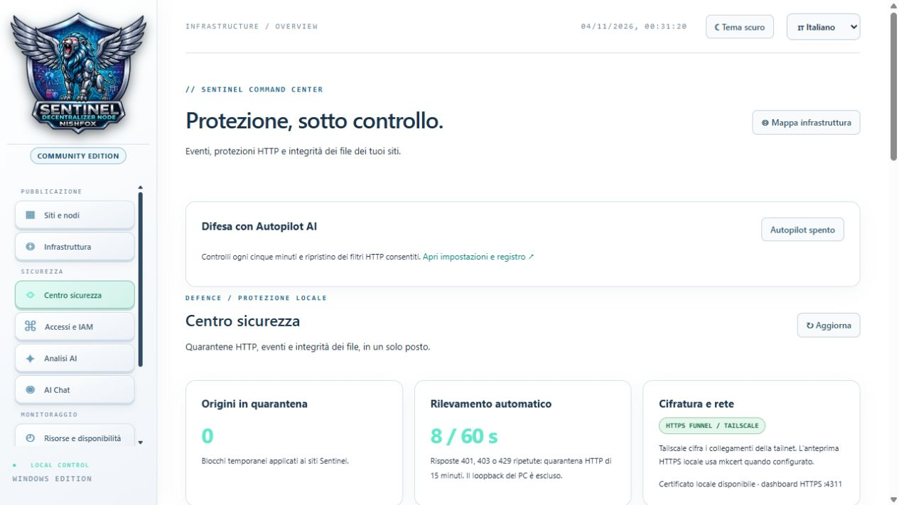
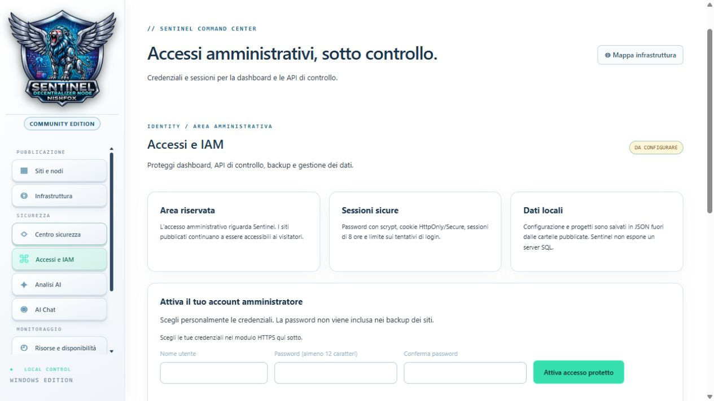
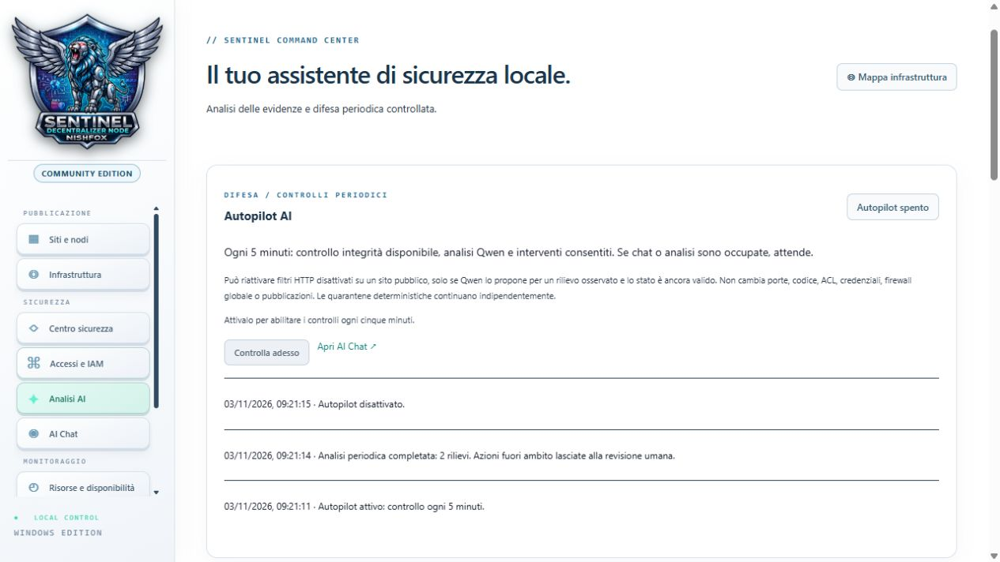
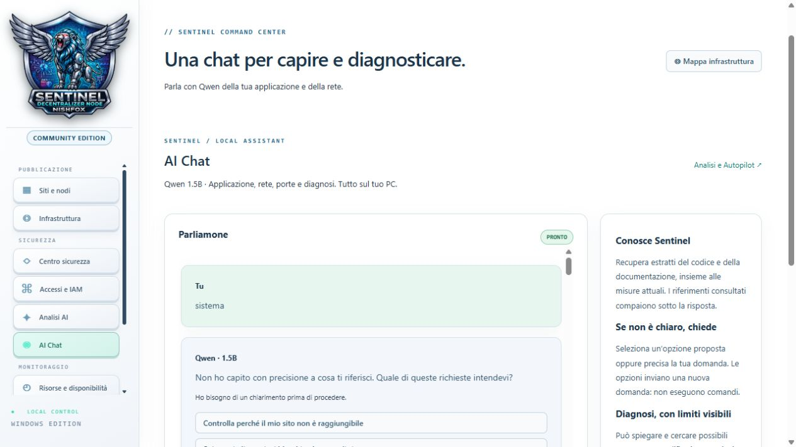
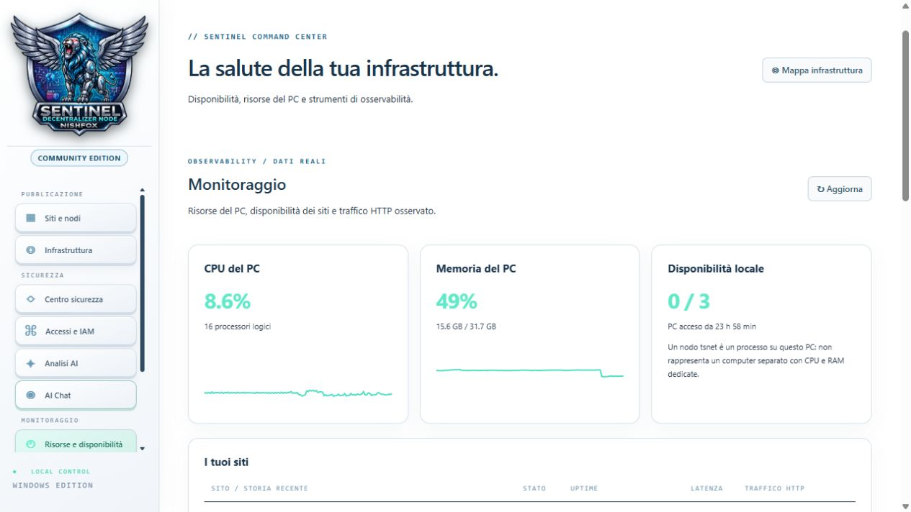
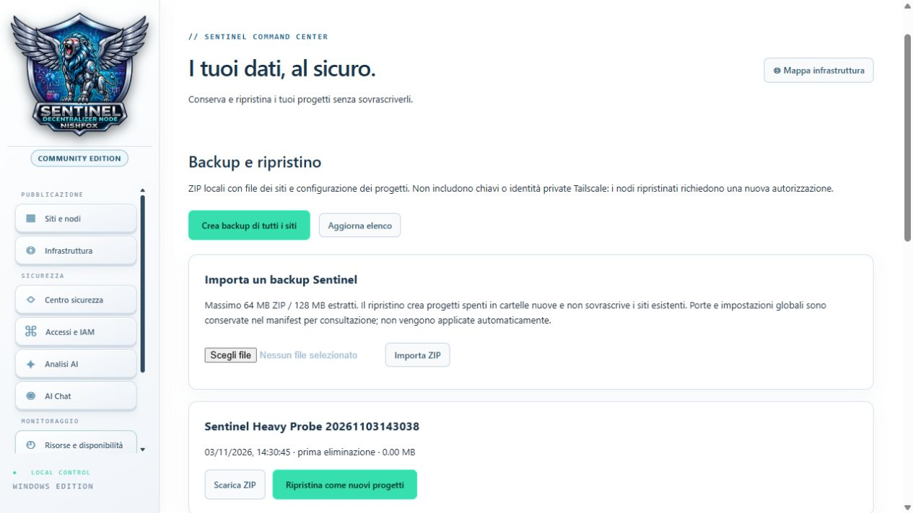
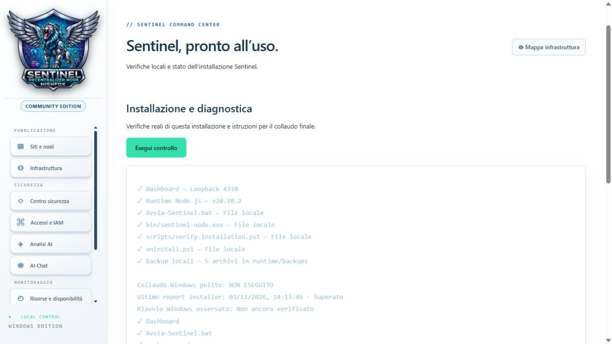

# Manuale illustrato di Sentinel

[English](manuale-ENG.md) · [Italiano](manuale.md)
Sentinel Decentralized Node · Community Edition

Ogni capitolo corrisponde a una pagina di stampa A4. Nel formato HTML, usa l’indice per saltare a una pagina e seleziona le immagini per ingrandirle.

## 01 · Benvenuto
Sentinel ospita siti statici già realizzati. Un progetto associa una cartella di file a un server locale e a un nodo Tailscale dedicato. Puoi tenerlo spento, provarlo localmente o pubblicarlo su Internet.
- **Esempio pratico** — Hai una cartella con index.html, style.css e immagini per un portfolio. Aggiungi un progetto Portfolio, copia quei file e apri l’anteprima.
- **Distinzione utile** — La pagina di esempio generata nella cartella serve a provare il server. Sostituiscila con i tuoi file.
- **Percorso consigliato** — Parti dalle pagine 2–8 per ospitare il primo sito. Passa a Infrastruttura per leggere gli stati e a Backup prima delle modifiche importanti.
## 02 · Primo avvio su Windows
- **Installer** — Completa il wizard, scegli la cartella dei progetti e imposta nome utente, password e conferma nella pagina amministratore.
- **Avvio quotidiano** — Apri il collegamento oppure Avvia-Sentinel.bat. Il launcher può riutilizzare un’istanza già attiva. Usa l’indirizzo della dashboard mostrato dal launcher.
- **Porte predefinite** — 4310 per HTTP e 4311 per HTTPS quando configurato. Le porte delle anteprime dei siti sono distinte.
- **Controllo iniziale** — Apri Accessi e IAM per verificare lo stato dell’account. Poi controlla la scheda del progetto prima di attivare la pubblicazione.
## 03 · Orientarsi nella dashboard
- **Pubblicazione** — Siti e nodi contiene le schede dei progetti. Infrastruttura rappresenta le connessioni.
- **Sicurezza** — Centro sicurezza raccoglie eventi e controlli. Accessi e IAM protegge la gestione. Analisi AI e AI Chat usano il modello locale quando disponibile.
- **Monitoraggio, Dati, Sistema** — Risorse e disponibilità mostra metriche e processi. Backup e ripristino gestisce gli ZIP. Installazione e diagnostica raccoglie i controlli del sistema.
- **Intestazione** — Tema bianco/scuro e selettore lingua sono accanto all’orologio. I log e parte della terminologia tecnica mantengono il testo originale.
## 04 · Aggiungere un progetto
- **Nuovo sito / nodo** — Apre il modulo. Inserisci il nome del progetto e controlla il nome richiesto per il nodo. Il nome del nodo identifica il progetto nella rete Tailscale.
- **Salva** — Sentinel prepara la cartella del progetto e la pagina di esempio se manca index.html. Il progetto compare nell’elenco.
- **Cartella** — Apre la posizione da popolare. Copia i file già pronti mantenendo la struttura delle sottocartelle.
- **Esempio** — Se il sito usa images/foto.jpg, copia anche images. Metti index.html nella radice della cartella assegnata, non dentro una sottocartella di esportazione.
## 05 · Provare un sito sul PC
- **Avvia** — Accende il server locale e avvia il collegamento del nodo dedicato. Il sito rimane privato finché non attivi la pubblicazione.
- **Anteprima** — Apre l’indirizzo locale. Se il comando è disabilitato, verifica che il server sia avviato.
- **Arresta** — Ferma il server e il nodo. La scheda e i file restano disponibili per un avvio successivo.
- **Diagnosi pratica** — Se compare la pagina di esempio, verifica di avere sostituito index.html. Se manca un’immagine, controlla nome, estensione e percorso relativo.
## 06 · Collegare il nodo Tailscale
- **Collega nodo** — Avvia il nodo del progetto. Il server locale e il nodo hanno stati separati.
- **Autorizza nodo** — Quando compare il collegamento, completa l’accesso dal sito ufficiale. Dopo l’autorizzazione, torna alla dashboard e controlla lo stato.
- **Nome e indirizzo** — Il nome proposto è una richiesta. Il dominio valido è quello assegnato da Tailscale.
- **Esempio** — Se l’anteprima funziona e la scheda chiede autorizzazione, il problema riguarda l’accesso del nodo alla tailnet. Controlla quel passaggio prima di riprovare la pubblicazione.
## 07 · Pubblicare e verificare HTTPS
- **Pubblica** — Con il nodo collegato, richiede l’attivazione di Funnel. Completa l’eventuale autorizzazione Funnel mostrata dalla scheda.
- **Apri pubblico / Copia URL / QR code** — Aprono, copiano o rappresentano l’indirizzo HTTPS del progetto. Usa l’URL esatto assegnato.
- **Verifica HTTPS** — Controlla DNS, certificato e risposta HTTP. Attendi il completamento della verifica se la pubblicazione è appena partita.
- **Rimuovi dal pubblico** — Chiude il Funnel del progetto. Per controllare l’accesso da un’altra rete, usa il telefono con Wi-Fi spento.
## 08 · Modificare, leggere i log ed eliminare
- **Modifica** — Per cambiare il titolo arresta il progetto e rimuovi la pubblicazione. L’identità del nodo resta associata al progetto.
- **Log** — Consulta gli eventi della scheda. Nel pannello generale cerca l’ora del tentativo e confrontala con il messaggio sulla scheda.
- **Svuota vista** — Pulisce la visualizzazione del log generale. Copia prima i messaggi che ti servono per la diagnosi.
- **Backup / Elimina** — Esporta prima un archivio. Elimina richiede conferma con il nome del progetto e crea un backup automatico prima di rimuovere la cartella. Controlla l’archivio prima di cancellare contenuti importanti.
## 09 · Infrastruttura, leggere la mappa
- **CONTROLLO** — Il PC e la dashboard avviano i servizi e raccolgono gli stati. Seleziona il riquadro PC per aprire la diagnostica locale.
- **WWW / SERVER** — Mostra il server del progetto. Ogni riga rappresenta un progetto separato.
- **F / FILTRO HTTP** — Mostra la protezione applicativa per quel sito. Seleziona il riquadro per vedere contatori e configurazione.
- **T / NODO + FUNNEL** — Mostra il nodo dedicato e la sua connessione. **I / ACCESSO PUBBLICO** riporta l’esito della verifica esterna.
## 10 · Colori, frecce e animazioni
- **Verde** — Indica un passaggio attivo o verificato secondo il controllo disponibile. Individua la colonna prima di interpretarlo.
- **Rosso** — Indica uno stato spento o un controllo fallito. Un server arrestato volutamente può produrre lo stesso colore di un servizio indisponibile.
- **Giallo** — Richiama attenzione, per esempio sulla VPN rilevata o su un passaggio da verificare. Il colore neutro indica dati sconosciuti o non verificati.
- **Frecce in movimento** — Rappresentano le direzioni del collegamento e il suo stato anche senza traffico. Usa i contatori per leggere le richieste osservate. Seleziona la freccia per aprire i dettagli del passaggio.
## 11 · Controlli locali, Windows Firewall e VPN
- **Aggiorna** — Richiede una lettura dello stato. Leggi l’orario per capire quanto sono recenti i dati.
- **PC e VPN** — Il pannello mostra nome del PC, interfacce VPN rilevate e ora del rilevamento. Una VPN rilevata lascia da verificare il percorso effettivo dei nodi.
- **Firewall** — I profili Windows sono mostrati in sola lettura. Il filtro F opera sul sito e si configura separatamente.
- **Esempio** — Se il nodo è connesso ma il server è spento, apri il dettaglio WWW e controlla il server locale prima di diagnosticare la rete.
## 12 · Diagnosi per collegamento
- **Server** — Leggi cartella, stato e ultimo controllo. Se il server risponde 404, verifica che la pagina richiesta esista e che index.html sia nella radice.
- **Filtro** — Leggi richieste, blocchi, richieste attive ed errori 5xx. Le cause dei blocchi aiutano a individuare il limite coinvolto.
- **Nodo** — Leggi dominio assegnato, stato e data dell’ultimo aggiornamento. Se appare Autorizza nodo, completa il login richiesto.
- **Internet** — Leggi DNS, TLS e HTTP separatamente. Il controllo usa il PC e un relay pubblico. Per verificare l’esperienza di un visitatore usa una rete separata.
## 13 · Centro sicurezza

- **Aggiorna** — Rilegge eventi, quarantene, integrità e stato degli strumenti. Confronta gli orari prima di attribuire un evento a un’azione recente.
- **Quarantena** — Scegli il progetto, inserisci l’indirizzo IP e la durata in minuti. Verifica l’identità dell’indirizzo prima di confermare.
- **Rimuovi blocco** — Annulla una quarantena locale dalla lista. Controlla CrowdSec se un blocco continua a essere osservato.
- **Eventi** — Leggi categoria e orario. Un rifiuto HTTP mostra che una richiesta è stata bloccata. Verifica il contesto prima di classificarlo come attacco.
## 14 · Filtri e integrità
- **Filtri HTTP** — Nel riquadro F puoi leggere e configurare limite richieste, concorrenza e dimensione del corpo. Parti dalle impostazioni correnti e cambia un limite alla volta.
- **Esempio 429** — Un client legittimo che riceve 429 può avere raggiunto il limite. Confronta il contatore dei blocchi con il traffico previsto prima di modificare la soglia.
- **Crea riferimento** — Registra gli hash dei file nella versione che hai verificato.
- **Controlla integrità** — Confronta i file con il riferimento e segnala aggiunte, modifiche e rimozioni. Dopo un aggiornamento voluto controlla le differenze prima di rinnovare il riferimento.
## 15 · Accessi e IAM

- **Stato account** — Il badge indica se la protezione amministrativa è attiva. Apri la dashboard HTTPS per configurare le credenziali.
- **Modulo** — Inserisci nome utente, password e conferma. La password prevista è di almeno 12 caratteri. Dopo l’attivazione verifica che il badge cambi.
- **Esci dalla dashboard** — Termina la sessione. Al prossimo accesso usa le credenziali amministrative.
- **Ambito** — Account e sessione proteggono il pannello, le API amministrative e i backup. I visitatori del sito pubblico usano l’URL del progetto.
## 16 · Sessioni e regole Tailscale
- **Sessione** — L’account usa una password memorizzata come hash. La sessione usa un cookie protetto e scade dopo otto ore. I tentativi ripetuti vengono limitati.
- **ACL e grants** — La sezione espone un esempio di regole per l’accesso privato. Valuta le regole nella console Tailscale rispetto ai dispositivi e agli utenti della tua tailnet.
- **Esempio** — Vuoi proteggere la gestione e tenere pubblico il portfolio. Attiva l’account Sentinel e prova separatamente il pannello locale e l’URL Funnel.
- **Accesso perso** — Verifica indirizzo HTTPS e credenziali. Evita tentativi ripetuti durante il blocco temporaneo.
## 17 · Analisi AI

- **Motore e modello** — La schermata indica disponibilità di Ollama e Qwen 2.5 1.5B. Installa i componenti opzionali prima del primo utilizzo.
- **Analisi AI** — Raccoglie informazioni aggregate su siti, porte, firewall, integrità e blocchi. Puoi continuare a usare la dashboard mentre elabora.
- **Annulla / Aggiorna stato** — Annulla la richiesta in corso oppure rileggi lo stato. **Esporta report** salva il testo del risultato disponibile.
- **Come leggerlo** — Parti dai rilievi verificati dal codice. Usa i consigli del modello come suggerimenti da confrontare con gli stati e i log.
## 18 · Autopilot

- **Interruttore** — L’Autopilot parte spento. Quando attivo, Sentinel programma controlli periodici ogni cinque minuti mentre il programma è in esecuzione.
- **Controlla adesso** — Richiede un ciclo senza attendere il prossimo intervallo. Chat e analisi condividono il motore, quindi attendi se è occupato.
- **Intervento previsto** — Può riattivare filtri HTTP spenti su un sito pubblico se il rilievo è verificato e lo stato è ancora valido.
- **Registro / Annulla intervento** — Controlla l’azione effettuata e ripristina la configurazione precedente quando disponibile. Spegni Autopilot se vuoi mantenere una scelta manuale incompatibile con quella regola.
## 19 · AI Chat

- **Invia a Qwen** — Scrivi una domanda specifica. Esempi utili sono «Quali porte usa la dashboard?» e «Qual è l’URL del sito 1?».
- **Chiarimenti** — Una richiesta come «non va» può produrre opzioni cliccabili. Scegli la domanda più vicina oppure specifica progetto, errore e passaggio.
- **Riferimenti consultati** — Apri la voce sotto una risposta per vedere gli estratti individuati. I dati certi del progetto possono provenire direttamente dal backend.
- **Annulla risposta / Cancella chat** — Ferma l’elaborazione oppure cancella la cronologia locale. Evita di inserire credenziali.
## 20 · Risorse e disponibilità

- **CPU e memoria** — Leggi utilizzo, numero di core e memoria disponibile. Confronta le misure prima e dopo l’avvio di un progetto o di un’analisi.
- **Disponibilità e siti** — Osserva lo stato dei progetti e lo storico disponibile. Controlla l’orario delle misure quando un servizio è appena cambiato.
- **Rete** — Le metriche del PC disponibili tramite Glances descrivono l’host. Per capire un errore di un singolo sito, confrontale con la mappa e con i suoi log.
- **Aggiorna** — Rileggi le metriche. Se la pagina segnala uno strumento spento, controlla la scheda dei processi.
## 21 · Strumenti locali e Uptime Kuma
- **Avvia / Arresta** — Gestisci i processi opzionali dalle schede. Valuta l’effetto sul monitoraggio o sulle analisi prima di arrestarne uno.
- **Apri pannello** — Apre l’interfaccia locale quando lo strumento espone un pannello. Kuma e Glances sono accessibili localmente quando installati e avviati.
- **Primo monitor Kuma** — Apri Kuma, scegli SQLite e configura il tuo account. Aggiungi un monitor HTTP(S), inserisci l’URL effettivo e controlla la prima misura.
- **Audit** — Le segnalazioni sulle dipendenze sono distinte dallo stato del processo. Verifica l’audit disponibile quando prepari una distribuzione.
## 22 · Backup, importazione e ripristino

- **Crea backup di tutti i siti** — Esporta i progetti. Il comando Backup sulla scheda permette di partire da un singolo progetto.
- **Aggiorna elenco / Scarica ZIP** — Rileggi gli archivi e scarica quello scelto. Verifica data, progetti inclusi e dimensione.
- **Importa ZIP** — Seleziona un archivio Sentinel e attendi la validazione. La schermata indica i limiti di dimensione.
- **Ripristina come nuovi progetti** — Crea copie spente senza sovrascrivere quelle esistenti. Verifica i file, avvia l’anteprima e autorizza di nuovo il nodo quando serve. Conserva chiavi e credenziali separatamente.
## 23 · Installazione e diagnostica

- **Esegui controllo** — Leggi la disponibilità della dashboard, del runtime, dei file del launcher, dell’helper nodi e dei backup.
- **Verifica installazione** — Lo script scripts/verify-installation.ps1 controlla anche il riuso del processo dal launcher. Il report locale descrive la macchina su cui è stato prodotto.
- **Collaudo completo** — Per una nuova macchina, prova installazione, doppio avvio del BAT, autorizzazione di un nodo di prova, accesso mobile, backup e ripristino, riavvio e disinstallazione.
- **Arresta Sentinel** — Ferma il pannello e i servizi gestiti. Riapri il BAT per tornare alla dashboard.
## 24 · Risolvere un problema passo per passo
1. Se il pannello non si apre, avvia il BAT e verifica l’indirizzo locale mostrato.
2. Se il sito non si apre, controlla la cartella e il server dalla scheda. Prova l’anteprima locale.
3. Se l’anteprima funziona, controlla nodo, autorizzazione e Funnel in Infrastruttura.
4. Se il Funnel è attivo, esegui Verifica HTTPS e leggi quale passaggio tra DNS, TLS e HTTP fallisce.
5. Se compare 403 o 429, leggi Centro sicurezza e il dettaglio del filtro. Correggi la causa prima di cambiare le soglie.
6. Quando chiedi aiuto, annota progetto, azione, ora, codice HTTP e messaggio pertinente. Oscura URL privati, token e percorsi personali prima di condividere il materiale.
## 25 · Esercitazione completa
1. Crea un progetto di prova chiamato Portfolio. Copia un sito statico già preparato e apri l’anteprima.
2. Cambia una riga in index.html, salva e ricarica la pagina. Se manca la modifica, verifica di avere aperto il progetto giusto.
3. Apri Infrastruttura. Individua la sua riga e confronta stato del server, nodo e accesso pubblico.
4. Crea un backup e ripristinalo come nuovo progetto. Controlla che l’originale e la copia abbiano cartelle distinte.
5. Se vuoi pubblicare il progetto di prova, autorizza il suo nodo e apri l’URL da una seconda rete. Poi seleziona Rimuovi dal pubblico e verifica lo stato.
6. Arresta il progetto di prova. Conserva l’archivio utile e consulta Diagnostica se un passaggio non ha dato l’esito previsto.

**Creato da Nishfox · Community Edition**
